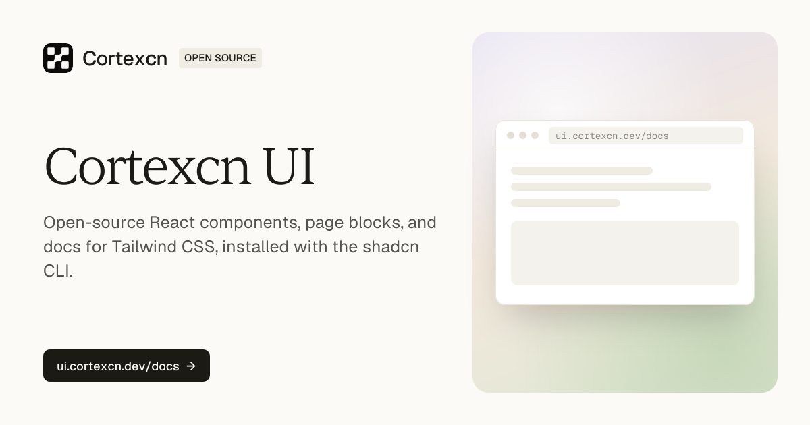

# Cortexcn UI

Open-source React components, page blocks, and docs for Tailwind CSS. Install any of them with the shadcn CLI: the code is copied into your project, so you can read it, change it, and make it your own.

[](https://github.com/Cortexcn/ui/actions/workflows/ci.yml)
[](./LICENSE)



## Documentation

Visit [ui.cortexcn.dev/docs](https://ui.cortexcn.dev/docs) for the docs, live previews, and install steps.

## What's inside

- **Components.** The shadcn/ui primitives, styled with the Cortexcn design tokens: accordion, dialog, select, tabs, sidebar, and the rest.
- **Blocks.** Free page sections for heroes, features, services, and loaders. [Browse the blocks](https://ui.cortexcn.dev/blocks).
- **AI tools.** An MCP server, agent skills, and a `DESIGN.md` file, so coding agents can find the right item, install it, and match the design system.
- **The docs website.** The Next.js site at [ui.cortexcn.dev](https://ui.cortexcn.dev), in `apps/web`.

## Install a component

Every item installs from its URL, with no registry setup:

```bash
npx shadcn@latest add https://ui.cortexcn.dev/r/button.json
```

Or register the `@cortexcn` namespace once in `components.json`:

```json
{
  "registries": {
    "@cortexcn": "https://ui.cortexcn.dev/r/{name}.json"
  }
}
```

and add items by name:

```bash
npx shadcn@latest add @cortexcn/button
```

## Use it with your AI agent

**MCP server.** Connect your assistant to `https://ui.cortexcn.dev/mcp` to search the catalog, read an item's docs and source, and get its install command. It is read-only and needs no sign-in. In Claude Code:

```bash
claude mcp add --transport http cortexcn https://ui.cortexcn.dev/mcp
```

Setup for Cursor, VS Code, Codex, Windsurf, Zed, and the chat apps is in the [MCP docs](https://ui.cortexcn.dev/docs/integration/mcp).

**Agent kit.** Skills that teach your agent to find, install, compose, and theme Cortexcn items, plus a `DESIGN.md` for your project root:

```bash
npx shadcn@latest add https://ui.cortexcn.dev/r/agent-kit.json
```

## Run the website locally

You need [Bun](https://bun.sh) 1.4 and Node.js 18 or later.

```bash
bun install
bun dev
```

Then open [localhost:4420/docs](http://localhost:4420/docs).

## What is in this repository

| Path | What it is |
| --- | --- |
| `apps/web` | The docs website: pages, docs, blocks, and the registry it serves |
| `packages/ui` | The library: components, hooks, utilities, styles, and agent files, plus `registry.json` and the scripts that build the registry |
| `packages/icons` | The site's icon component |
| `templates` | Free starter templates |

## Cortexcn Pro

The Cortexcn components (such as Marquee, Number Ticker, Gooey Nav, Sphere Menu, and Lanyard), the AI components, the charts, and the Pro blocks are a paid product, [Cortexcn Pro](https://www.cortexcn.dev/pro), and their source is not in this repository. Where the site shows something built with Pro, this repository shows a placeholder card instead.

## Contributing

Please read the [contributing guide](./CONTRIBUTING.md). Report security problems privately, as [SECURITY.md](./SECURITY.md) describes.

## License

Licensed under the [MIT license](./LICENSE), except the items listed in [NOTICE.md](./NOTICE.md), which keep their original licenses.

A product by Cortexcn. Building in public at [@SyedMoin](https://x.com/SyedMoin).
